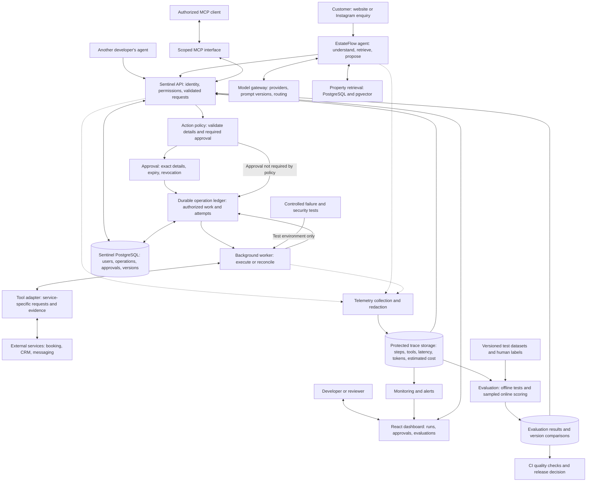
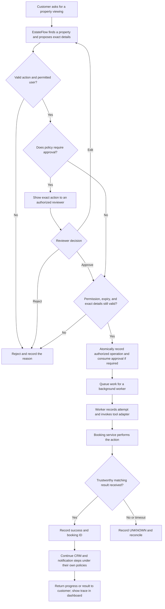
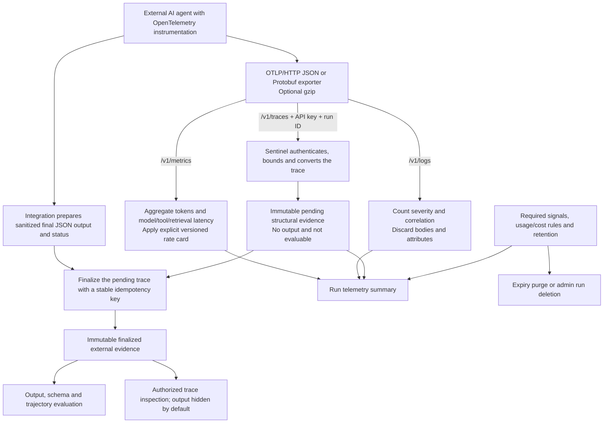
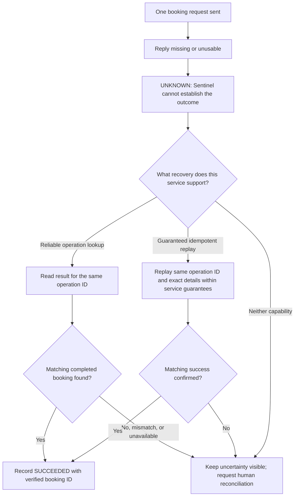
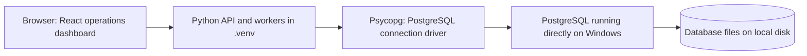

# Architecture explained through flowcharts

These diagrams show the intended full product, combining the original Sentinel
proposal and the additional reliability work. They are not a claim that all parts
exist today. PostgreSQL directly on Windows is now the selected local setup;
installation and persistence verification have passed. Docker is excluded from
the selected workflow. Native processes and a managed database are the deployment
alternatives; the existing optional container example is not required.

## 1. The complete product

The adapter runtime now supports deployment-installed custom contracts in addition
to default booking. A durable local support-ticket sandbox verifies the second
adapter path. PostgreSQL shares per-key request limits across API instances, and
the dashboard displays tenant-scoped operational counters. Real external
calendar/CRM/email providers and hosted validation remain target architecture.

The native scheduling path now connects a qualified lead's frozen version to an
offered property slot, exact-action approval, an overlap-safe native reservation
and internal CRM/follow-up records. Cancellation invalidates linked unsent drafts.
The original fictional booking configuration remains separately supported; neither
path proves a real external calendar/CRM/email integration. See the
[automatic native workflow](native-calendar.md#automatic-lead-bound-native-workflow).

The currently implemented MCP path is a desktop subprocess calling the Sentinel
API with an environment-provided service key. It exposes only identity, safe run
summaries, and redacted timelines. Remote MCP/OAuth and dataset/policy tools remain
target architecture. See [MCP integration](mcp-integration.md) for setup and limits.

Solid arrows represent requests or data flow; dotted arrows collect telemetry.
Read the main action path from top to bottom. The bottom branches inspect, test,
and improve the system; they are not all mandatory steps in every booking.
The storage boxes show responsibilities, not a requirement for separate servers
or databases. EstateFlow business data and Sentinel control records must have
clear ownership even if local development initially shares a PostgreSQL instance.

EstateFlow solves the property business task. Sentinel controls and inspects the
agent's actions. Other agents can use Sentinel without using EstateFlow.

## 2. One appointment request

Approval and execution are different. Saving authorized work does not mean the
external appointment exists. Likewise, booking success does not mean a later CRM
update succeeded. Each external action has its own identity and recorded outcome.
The queue is a delivery mechanism; the ledger is the durable record of work. A later
implementation must bridge database commit and queue delivery reliably.

## External agent telemetry and finalization

Receipt and finalization are separate so an exporter cannot accidentally claim that
an empty object is the agent's real output. Replayed identical telemetry/finalization
is safe; different evidence for the same run conflicts. Telemetry is caller-reported
and does not authorize external actions or change governed tool/model ledgers.

## 3. Recovery when a reply goes missing

The lookup branch is demonstrated in Lesson 5. The replay-capability branch is
planned, not yet part of that execution loop. Services supporting both can use
lookup first. 'Not found' does not automatically authorize another write. Recovery
rules must account for pending requests, stale reads, and idempotency-key retention.

## 4. Our local setup choice

This is the selected and verified development setup. Native PostgreSQL 17.11 runs
from the ignored project-local directory and has passed persistence, restart,
transaction, concurrency, API, and workflow-checkpoint checks.

## What exists today

- Implemented: durable multi-tenant operation and run ledgers, exact approvals,
  leased workers, evidence-only crash recovery, agent/tool registry, model gateway,
  encrypted provider credentials, and PostgreSQL-checkpointed LangGraph workflow.
- Implemented: professional React dashboard and property-search interface plus
  versioned EstateFlow ingestion, evidence-backed full-text/trigram retrieval,
  versioned embeddings, exact array-cosine search, and frozen per-run
  recommendations inside the durable workflow.
- Implemented: encrypted lead intake, rule-based qualification, human-review
  routing, and a lead-bound booking gate that rechecks the lead before execution.
- Implemented: internal CRM contact projection and encrypted follow-up drafts with
  reviewer approval, created durably after confirmed lead bookings.
- Implemented: property-bound booking ID/version evidence, availability checks
  before execution, post-booking lead-change review, encrypted draft editing with
  revision-specific approval, and independently reported per-run action outcomes.
- Implemented: versioned business-rule evaluation datasets, frozen saved-run
  reports, comparisons, a gate command, and dashboard evaluation/run timelines.
- Implemented: native database backups and temporary restore rehearsal with
  snapshot table counts and preserved encrypted lead readability.
- Implemented: service-key lifecycle/admin UI, access audit and concurrent admin
  protection, Python HTTP client, and a separate read-only support-triage example.
- Prepared: optional pgvector migration and deployment configuration. Its exact
  pgvector query path still needs a working extension and live validation.
- Planned: later EstateFlow actions and external enquiry/handoff integrations, tracing,
  evaluation/security labs, MCP integration, production identity, and deployment.

The website delivery API now deduplicates retries and rejects stale updates. The
dashboard queues viewing runs, and the native worker advances them through exact
approval and booking. External adapter interfaces remain a next milestone.
CRM currently means an internal database projection, and draft
approval does not send email. Live pgvector validation and a measured real-model
retrieval comparison remain open.

